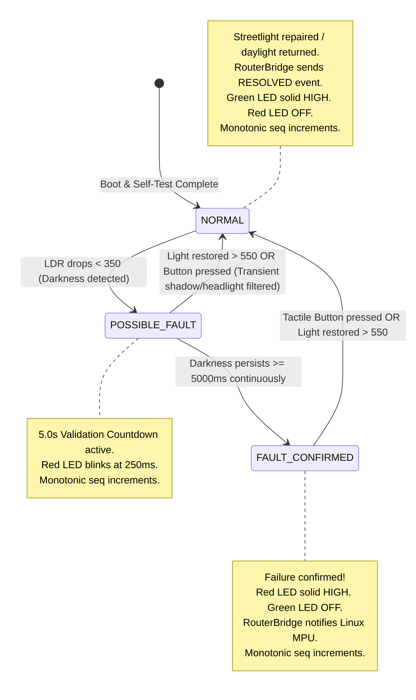

# JanSetu IoT Edge Node — Hardened Arduino UNO Q MCU Firmware

This directory contains the production-grade microcontroller (MCU) firmware for the **JanSetu IoT Edge Streetlight Monitoring Device** running on the **Arduino UNO Q** hybrid platform.

---

## 1. Architectural Overview

The **Arduino UNO Q** combines two computing cores on a single board:
1. **Real-time MCU (Microcontroller Core)**: Executes this C++ firmware (`sketch.ino`) to continuously sample sensors, debounce physical buttons, manage LED indicators, pet the hardware watchdog, and execute a Finite State Machine (FSM).
2. **Linux MPU (Microprocessor Core)**: Runs Python (`IOT/python/main.py`), polling the MCU state across the inter-processor **RouterBridge RPC** interface and uploading confirmed faults/resolutions to the JanSetu Cloud Backend.

```text
┌──────────────────────────────────────────────────────────────────────────────────┐
│                             ARDUINO UNO Q HARDWARE                               │
│                                                                                  │
│   ┌─────────────────────────────┐           ┌────────────────────────────────┐   │
│   │     Real-Time MCU Core      │           │        Linux MPU Core          │   │
│   │        (C++ Firmware)       │           │        (Python Agent)          │   │
│   │                             │   RPC     │                                │   │
│   │  - Rolling Average LDR      │ ◄───────► │  - RouterBridge Poller         │   │
│   │  - Hysteresis Deadband      │  Bridge   │  - Background Retry Queue      │   │
│   │  - 3-State Filter FSM       │           │  - HTTPS Event Dispatcher      │   │
│   │  - Monotonic Sequence (seq) │           │                                │   │
│   │  - Hardware Debounced Btn   │           └──────────────┬─────────────────┘   │
│   │  - 4s Watchdog Timer (WDT)  │                          │                     │
│   └──────────────▲──────────────┘                          │ HTTPS POST          │
│                  │                                         │ (JSON Payload)      │
└──────────────────┼─────────────────────────────────────────┼─────────────────────┘
                   │ Wiring                                  ▼
         ┌─────────┴─────────┐                  ┌────────────────────────┐
         │ Sensor & Actuator │                  │  JanSetu Cloud Backend │
         │    Breadboard     │                  │   (Express + PostGIS)  │
         │ - LDR Module (A0) │                  └────────────────────────┘
         │ - White LED  (D9) │
         │ - Green LED  (D8) │
         │ - Red LED    (D7) │
         │ - Button     (D2) │
         └───────────────────┘
```

---

## 2. Hardware Pinout & Wiring Specifications

| Pin | Direction | Component / Role | Electrical Interface | Operational Behavior |
| :--- | :--- | :--- | :--- | :--- |
| **`A0`** | Analog Input | **LDR (Light Dependent Resistor)** | Voltage Divider with 10kΩ pull-down resistor to GND. | 10-bit ADC reading (0–1023). High values (>550) indicate bright light; low values (<350) indicate darkness. |
| **`D9`** | Digital Output | **White LED** (Streetlight Luminaire) | Connected via 220Ω current-limiting resistor to GND. | Simulates fixture luminaire output. Commanded HIGH during normal operation. |
| **`D8`** | Digital Output | **Green LED** (Normal Status) | Connected via 220Ω current-limiting resistor to GND. | Solid HIGH when system is in `STATE_NORMAL`. LOW during anomaly or fault. |
| **`D7`** | Digital Output | **Red LED** (Fault / Warning Indicator) | Connected via 220Ω current-limiting resistor to GND. | OFF in `STATE_NORMAL`. Fast blinking (250ms) during `POSSIBLE_FAULT` countdown. Solid HIGH in `STATE_FAULT_CONFIRMED`. |
| **`D2`** | Digital Input | **Tactile Push Button** (Repair Simulation) | Configured with internal pull-up (`INPUT_PULLUP`). | Normally HIGH. Actively pulled LOW (GND) when pressed. Debounced over a 50ms window. |

### Breadboard Wiring Schematic
```text
  [5V Rail] ──┬─────────────┐
              │             │
             [LDR]         [Push Button]
              │             │
  Pin A0 ─────┼──[10kΩ]     └── Pin D2 (INPUT_PULLUP)
              │    │
  [GND Rail] ─┴────┴────────┬──────────────────┬──────────────────┐
                            │                  │                  │
                          [220Ω]             [220Ω]             [220Ω]
                            │                  │                  │
                         [White LED]        [Green LED]        [Red LED]
                            │                  │                  │
  Pins:                   Pin D9             Pin D8             Pin D7
```

---

## 3. Signal Filtering & Threshold Calibration

### 3.1 Rolling-Average LDR Sampling
Analog photodetectors are subject to environmental noise, passing vehicle headlights, shadows from birds or foliage, and cloud transitions. To prevent false triggering:
- **Sample Rate**: The MCU samples `analogRead(A0)` at a fixed non-blocking interval of **`LDR_SAMPLE_INTERVAL_MS = 50ms`** (20 Hz).
- **Circular Buffer**: Readings are pushed into a 16-element rolling window (`LDR_WINDOW_SIZE = 16`).
- **Filtered Value**: The moving average is calculated continuously:
  $$\text{LDR}_{\text{avg}} = \frac{1}{N}\sum_{i=0}^{N-1}\text{ADC}_i \quad (N=16)$$
  This low-pass filter completely attenuates brief impulse spikes (<800ms) without introducing excessive phase lag.

### 3.2 Hysteresis Deadband
To prevent output "chatter" when ambient illumination hovers near the switching boundary:
- **`THRESHOLD_DARK = 350`**: Illumination must drop **below 350** for the sensor to register darkness.
- **`THRESHOLD_LIGHT = 550`**: Illumination must rise **above 550** for the sensor to register daylight/illumination restoration.
- **Deadband (350 to 550)**: Within this 200-count margin, the sensor preserves its previous state, preventing oscillation from fluctuating twilight or cloud cover.

---

## 4. Finite State Machine (FSM) Specification

The system implements a 3-state deterministic Finite State Machine to eliminate false positives:



### Detailed State Transitions

| State | Indicator LEDs | Entry Condition | Exit Condition & Next State | Sequence (`seq`) |
| :--- | :--- | :--- | :--- | :--- |
| **`NORMAL`** | Green: **ON**<br>Red: **OFF**<br>White: **ON** | System boot or recovery from fault. | Triggered when filtered LDR drops below `THRESHOLD_DARK` (350).<br>$\rightarrow$ Transitions to **`POSSIBLE_FAULT`**. | Increments on entry (+1). |
| **`POSSIBLE_FAULT`** | Green: **OFF**<br>Red: **BLINK (250ms)**<br>White: **ON** | Filtered LDR fell below 350 in `NORMAL`. Starts a 5000ms validation countdown. | **A. False Alarm:** Illumination recovers above 550 before 5s elapses.<br>$\rightarrow$ Transitions back to **`NORMAL`**.<br>**B. Confirmed Failure:** Darkness persists for $\ge 5000\text{ms}$.<br>$\rightarrow$ Transitions to **`FAULT_CONFIRMED`**.<br>**C. Manual Reset:** Button pressed.<br>$\rightarrow$ Transitions to **`NORMAL`**. | Increments on transition (+1). |
| **`FAULT_CONFIRMED`** | Green: **OFF**<br>Red: **SOLID ON**<br>White: **ON** | Darkness persisted uninterrupted for $\ge 5.0\text{s}$. | **A. Tactile Button Pressed:** Physical repair simulated by field technician.<br>$\rightarrow$ Transitions back to **`NORMAL`**.<br>**B. Ambient Light Restored:** Sun rises or fixture repaired.<br>$\rightarrow$ Transitions back to **`NORMAL`**. | Increments on transition (+1). |

---

## 5. Reliability & Fault Recovery

### 5.1 Monotonic Event Sequence Counter (`seq`)
Every state transition strictly increments a 32-bit unsigned integer counter `event_seq`. This counter:
- Starts at `1` upon power-on reset.
- Is monotonically increasing across all state shifts (`NORMAL` $\rightarrow$ `POSSIBLE_FAULT` $\rightarrow$ `FAULT_CONFIRMED` $\rightarrow$ `NORMAL`).
- Enables the Linux MPU and cloud backend to detect missed polls, duplicate reports, or out-of-order event delivery.

### 5.2 Hardware Push Button Debounce
Mechanical contacts in tactile push buttons generate contact chatter for 5ms to 25ms upon actuation.
- The `button.cpp` driver samples the pin state continuously.
- It requires the input to remain stable for at least **`DEBOUNCE_DELAY_MS = 50ms`** before recognizing a transition.
- An edge detector guarantees that exactly **one** repair event is registered per physical push, regardless of how long the button is held down.

### 5.3 Hardware Watchdog Timer (WDT)
To guarantee 24/7 autonomous recovery from transient voltage dips, electromagnetic interference (EMI), or software deadlocks:
- A 4-second hardware watchdog timer (`wdt_enable(WDTO_4S)`) is initialized during `setup()`.
- The main `loop()` pets the watchdog on every cycle via `wdt_reset()`.
- If the microcontroller locks up or blocks for $>4000\text{ms}$, the hardware watchdog triggers an automatic hardware reset, returning the system to safe operational defaults.

---

## 6. Communication & RPC Interfaces

The MCU firmware exposes two transport mechanisms:

### 6.1 RouterBridge RPC (MCU $\leftrightarrow$ Linux MPU)

The firmware registers RPC handlers with the Arduino `RouterBridge` daemon:

1. **`get_status()` $\rightarrow$ String**:
   - Returns: `"NORMAL"`, `"POSSIBLE_FAULT"`, or `"FAULT_CONFIRMED"`.
   - Preserves 100% backward compatibility with legacy polling agents.

2. **`get_telemetry()` $\rightarrow$ Structured JSON String**:
   - Returns comprehensive telemetry object:
     ```json
     {
       "state": "NORMAL",
       "ldr_raw": 785,
       "seq": 1,
       "uptime_ms": 142500,
       "fault_duration_ms": 0
     }
     ```
   - When in `FAULT_CONFIRMED`, `fault_duration_ms` reflects the elapsed duration since failure confirmation.

3. **`simulate_repair()` $\rightarrow$ Boolean**:
   - Programmatically triggers a simulated repair event, facilitating remote automated testing from the Linux MPU.

### 6.2 USB Serial Diagnostic Console (115200 Baud)

For standalone bench testing without the Linux MPU, the MCU firmware accepts interactive ASCII commands over the USB Serial monitor:

| Command | Response | Description |
| :--- | :--- | :--- |
| `STATUS` | `NORMAL` / `POSSIBLE_FAULT` / `FAULT_CONFIRMED` | Queries the current raw FSM state. |
| `TELEMETRY` or `GET` | `{"state":"NORMAL","ldr_raw":785,"seq":1,"uptime_ms":142500,"fault_duration_ms":0}` | Returns the structured JSON telemetry payload. |
| `REPAIR` | `OK: REPAIR_TRIGGERED` | Simulates a physical push button actuation. |
| `RESET` | `OK: FSM_RESET` | Re-initializes the state machine to `STATE_NORMAL`. |

Additionally, the MCU automatically outputs a periodic heartbeat line every 2000ms:
```text
[JANSETU-MCU] {"state":"NORMAL","ldr_raw":785,"seq":1,"uptime_ms":2000,"fault_duration_ms":0}
```

---

## 7. Modular Source File Inventory

```text
iot/sketch/
├── pins.h              # Hardware pin assignments, ADC thresholds, and timing parameters
├── sensors.h           # Rolling-average circular buffer and hysteresis declarations
├── sensors.cpp         # 16-sample ADC moving average filter and deadband implementation
├── button.h            # Non-blocking tactile push button debouncer interface
├── button.cpp          # 50ms stable-state debounce and falling-edge event detector
├── outputs.h           # White, Green, and Red indicator LED controllers
├── outputs.cpp         # Pin mode setup and FSM state LED visualization logic
├── fsm.h               # Finite State Machine state enum and TelemetryData struct
├── fsm.cpp             # 3-state validation countdown, seq tracking, and recovery logic
├── communication.h     # RouterBridge RPC bindings and JSON formatting interface
├── communication.cpp   # RPC method registrations and Serial diagnostic terminal
├── sketch.ino          # Main Arduino firmware entrypoint with 4s Watchdog Timer
├── test_firmware.cpp   # Native C++ host unit test suite verifying all MCU logic
└── README.md           # This comprehensive architecture and reference manual
```

---

## 8. Verification & Host Unit Testing

A native host test suite (`test_firmware.cpp`) compiles the actual C++ firmware modules with standard `g++` to verify all timing, filtering, and state transitions without requiring physical Arduino hardware.

### Execute Host Verification Tests
```bash
g++ -Wall -Wextra -std=c++11 -I IOT/sketch \
  IOT/sketch/sensors.cpp \
  IOT/sketch/button.cpp \
  IOT/sketch/outputs.cpp \
  IOT/sketch/fsm.cpp \
  IOT/sketch/communication.cpp \
  IOT/sketch/test_firmware.cpp \
  -o test_firmware && ./test_firmware && rm test_firmware
```

### Verified Test Assertions
```text
========================================
 JanSetu MCU Firmware Unit Verification 
========================================
[TEST] 1. Rolling-Average LDR Sampling & Hysteresis... PASSED
[TEST] 2. Push Button Hardware Debounce... PASSED
[TEST] 3. FSM Validation Countdown & Transitions... PASSED
[TEST] 4. Structured RPC Telemetry Serialization... PASSED
[TEST] 5. Outputs and LED Indication... PASSED

>>> ALL 5 MCU FIRMWARE TEST SUITES PASSED SUCCESSFULLY! <<<
```
