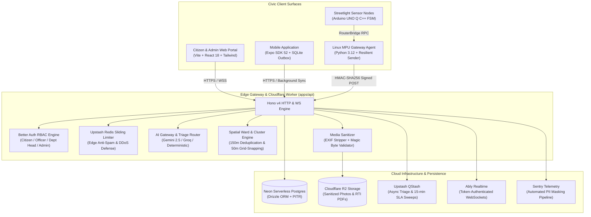

# JanSetu Multiverse (जनसेतु)

> **Enterprise Civic Grievance Intelligence, Autonomous Spatial Triage & IoT Edge Telemetry Monorepo**  
> *Connecting Citizens, Municipal Officers, and Civic Hardware Across Delhi NCR.*

[](https://github.com/PRIYANKA-NEGI-28/JANSETU-MULTIVERSE/actions/workflows/ci.yml)
[](https://github.com/PRIYANKA-NEGI-28/JANSETU-MULTIVERSE/actions/workflows/db-backup.yml)
[](https://pnpm.io)
[](https://www.typescriptlang.org)
[](https://workers.cloudflare.com)
[](https://neon.tech)
[](https://expo.dev)
[](https://playwright.dev)
[](docs/SECURITY.md)

---

## 1. System Architecture

JanSetu Multiverse is a production-grade **pnpm monorepo** uniting bilingual citizen intake, offline-first mobile sync, edge municipal hardware telemetry, and an automated civic triage graph:



---

## 2. Monorepo Workspace Structure

```text
JANSETU-MULTIVERSE/
├── .github/
│   └── workflows/
│       ├── ci.yml                 # Full CI: lint, typecheck, unit, integration, build, audit, E2E
│       └── db-backup.yml          # Scheduled weekly Neon Postgres snapshots to Cloudflare R2
├── apps/
│   ├── api/                       # Cloudflare Workers / Node.js Hono Edge API Engine
│   │   ├── src/
│   │   │   ├── auth/              # Better Auth integration & demo role simulation
│   │   │   ├── middleware/        # IoT HMAC-SHA256, RBAC, Upstash rate limiting, error handler
│   │   │   ├── routes/            # complaints, clusters, iot, rti, admin, media, meta, geo, ai
│   │   │   ├── serializers/       # Public vs Officer DTOs (strictly stripping citizen PII)
│   │   │   ├── services/          # AI gateway, complaint store, spatial clustering, storage
│   │   │   └── lib/sentry.ts      # Zero-dependency Sentry error monitoring with PII scrubber
│   │   └── wrangler.toml          # Cloudflare Workers & QStash production configuration
│   ├── mobile/                    # Expo SDK 52 React Native Application
│   │   ├── app/                   # Expo Router layout & screens (Home, Submit, Track, Hazards, RTI, Admin)
│   │   ├── src/
│   │   │   ├── offline/           # SQLite persistent outbox, exponential backoff sync engine
│   │   │   ├── contexts/          # LanguageContext (Hindi/English), AuthContext
│   │   │   └── lib/               # api-client, audioRecorder, imageCompressor, sentry
│   │   └── eas.json               # Expo EAS Android APK preview build configuration
│   └── web/                       # Vite + React 18 + Tailwind CSS Civic Portal
│       ├── src/
│       │   ├── components/        # ErrorBoundary, Navbars, Leaflet maps, KPI cards, Drawer
│       │   ├── pages/             # Home, Submit, Track, HazardMap, RTIDrafter, AdminDashboard
│       │   └── lib/               # api client, imageCompression (EXIF stripper), sentry
│       └── public/
│           ├── _redirects         # Cloudflare Pages SPA client-side routing fallback
│           └── _headers           # Immutable asset cache headers & security headers
├── packages/
│   ├── db/                        # Drizzle ORM schema, spatial queries, and Neon database client
│   └── shared/                    # Canonical TypeScript interfaces, 476-key i18n matrix, SLA policies
├── iot/
│   ├── sketch/                    # Arduino UNO Q C++ firmware (16-sample LDR buffer, 3-state FSM, watchdog)
│   └── python/                    # Linux MPU edge gateway (resilient sender, HMAC-SHA256 signer, simulator)
├── e2e/                           # Playwright full-stack E2E user journey tests
├── docs/
│   ├── SECURITY.md                # STRIDE threat model, 3-tier data classification, incident response
│   ├── DEPLOYMENT.md              # Zero-cost free-tier provisioning runbook (Neon, Cloudflare, Upstash)
│   └── MIGRATION_MAP.md           # Monorepo architectural migration blueprint
└── scripts/
    ├── smoke-test.ts              # Automated post-deployment API verification suite (7/7 checks)
    ├── db-backup.sh               # Standalone pg_dump gzip + SHA-256 backup script with R2 sync
    └── bundle-size-report.mjs     # Web production chunk and gzip analyzer
```

---

## 3. Key Engineering Highlights & Innovations

### 3.1 Autonomous Spatial Deduplication & Clustering
- When a citizen files a grievance, [`ComplaintStore`](file:///Users/apple/Desktop/JANSETU-MULTIVERSE/apps/api/src/services/complaint-store.ts) searches for existing open incidents within a **150-meter radius** reported within the past **7 days**.
- Duplicates are linked to a single canonical `ClusterEntity`, incrementing report counts and updating urgency rather than creating duplicate dispatches for municipal workers.

### 3.2 Dual-Language Statutory RTI Section 6(1) Drafting
- Citizens can convert any unresolved municipal grievance cluster into a legally binding Right to Information (RTI) application under Section 6(1) of the RTI Act, 2005.
- Produces bilingual Hindi (`प्रपत्र 'क'`) and English drafts with statutory questions, BPL fee exemption clauses, and generates an official downloadable PDF via `pdf-lib`.

### 3.3 Offline-First Mobile Sync Engine
- Built with `expo-sqlite` and `expo-file-system` ([`apps/mobile/src/offline/`](file:///Users/apple/Desktop/JANSETU-MULTIVERSE/apps/mobile/src/offline/)).
- When citizens report civic issues in low-connectivity areas, complaints and captured images are stored in a local SQLite transactional outbox.
- Background sync engine retries submissions using exponential jittered backoff (`delay = base * 2^attempt + jitter`) upon network reconnection.

### 3.4 Cryptographic IoT Edge Hardware Telemetry
- Streetlight poles run an Arduino UNO Q C++ firmware state machine ([`iot/sketch/`](file:///Users/apple/Desktop/JANSETU-MULTIVERSE/iot/sketch/)) with a 16-sample circular buffer rolling-average filter and anti-flicker hysteresis deadband (350/550).
- The Linux MPU Python agent signs every outgoing telemetry payload with HMAC-SHA256 (`X-Device-Signature`, `X-Device-Timestamp`, `X-Device-Id`).
- When a hardware fault is detected (`FAULT_CONFIRMED`), an incident cluster is automatically spawned on municipal maps; when repaired (`FAULT_CLEARED`), the cluster auto-resolves with an `IOT_CLEARED` audit record.

### 3.5 Privacy by Design & Security Hardening
- **Citizen Location Privacy:** Exact GPS coordinates, phone numbers, emails, and names are **never** returned over public endpoints. Public endpoints receive spatially obfuscated coordinates snapped to a ~50-meter municipal centroid (`obfuscatePublicCoords`).
- **Client-Side EXIF Stripping:** Smartphone photos have camera and GPS metadata stripped client-side in Web (`preserveExif: false` + Canvas fallback) and Mobile (`ImageManipulator`) before network transfer.
- **Server-Side Binary Magic Bytes:** Server rejects spoofed uploads by verifying raw binary headers (JPEG `FF D8 FF`, PNG `89 50 4E 47`, WebP `RIFF...WEBP`, WebM, WAV, MP4) and enforces 5MB image / 10MB audio caps.
- **Sentry PII Scrubbing:** All error tracking across API, Web, and Mobile incorporates regex redaction pipelines masking Indian mobile numbers (`[REDACTED_PHONE]`), emails, Aadhaar (12-digit), PAN cards, tokens, and drops client IP addresses.

---

## 4. Seeded Demo Accounts & RBAC Matrix

JanSetu includes deterministic demo tokens to facilitate interactive verification and automated E2E testing:

| Role | Demo Bearer Header | Identity | Permissions & Scope |
| :--- | :--- | :--- | :--- |
| **Citizen** | `Bearer demo-token-citizen` | Ramesh Sharma | File grievances, view owned tracking timelines, generate Section 6(1) RTI applications. |
| **Ward Officer** | `Bearer demo-token-ward_officer` | Anjali Verma (Ward 01) | Triage ward queue, inspect exact GPS coordinates, upload inspection notes, update resolution status. |
| **Department Head** | `Bearer demo-token-dept_head` | Vikram Singh (PWD) | Departmental analytics, reassign inter-departmental clusters, review SLA breach warnings. |
| **Administrator** | `Bearer demo-token-admin` | District Collector | Universal access: city-wide analytics, SLA policy overrides, officer allocations. |

---

## 5. Local Development Quickstart (<5 Minutes)

### Prerequisites
- [Node.js](https://nodejs.org) >= 20.x
- [pnpm](https://pnpm.io) >= 9.x (`corepack enable pnpm`)
- [Python](https://python.org) >= 3.12 with [uv](https://github.com/astral-sh/uv) (`curl -LsSf https://astral.sh/uv/install.sh | sh`)

### 1. Clone & Install Dependencies
```bash
git clone https://github.com/PRIYANKA-NEGI-28/JANSETU-MULTIVERSE.git
cd JANSETU-MULTIVERSE
pnpm install
```

### 2. Configure Environment
```bash
cp .env.example .env
cp apps/mobile/.env.example apps/mobile/.env
```

### 3. Start Development Servers
```bash
# Starts Node Hono API (port 3000) and Vite Web Portal (port 5173) in parallel
pnpm dev
```
Open **[http://localhost:5173](http://localhost:5173)** in your browser.

### 4. Run the IoT Streetlight Simulator
```bash
cd iot/python
uv venv
uv pip install -r requirements.txt
uv run python simulator.py --scenario streetlight_outage --delay 1
```

---

## 6. Verification & Test Suite Summary

Every commit is gated through a comprehensive automated verification matrix:

```bash
# 1. Monorepo Lint & Strict Typecheck across 5 packages
pnpm lint && pnpm typecheck

# 2. Run All Unit & Integration Tests (182 tests)
pnpm test

# 3. Run Python IoT Edge Gateway Tests (13 tests)
pytest iot/python

# 4. Run Playwright Full-Stack E2E User Journeys (4 tests)
pnpm test:e2e

# 5. Run Post-Deployment Live Smoke Tests (7/7 checks)
pnpm smoke-test

# 6. Supply Chain Security Audit
pnpm audit --audit-level=high
```

### Verified Empirical Test Metrics

| Test Suite | Scope | Target | Result | Latency |
| :--- | :--- | :--- | :--- | :--- |
| **Unit & Integration** | `@jansetu/api`, `@jansetu/mobile`, `@jansetu/shared`, `@jansetu/db`, `@jansetu/web` | Vitest v5 | **182 / 182 Passed** | 3.9s |
| **IoT Edge Gateway** | `iot/python` (Signer, Poller, Outbox, Simulator) | Pytest v9 | **13 / 13 Passed** | 0.14s |
| **Full-Stack E2E** | Live API + Web UI (Citizen, Officer, IoT, RTI) | Playwright | **4 / 4 Passed** | 8.7s |
| **Live Smoke Test** | Post-deploy probe (`/health`, auth, geo, intake, IoT, RBAC, RTI) | Node TSX | **7 / 7 Passed** | 81ms |
| **Supply Chain Audit** | Transitive dependencies across workspace | pnpm audit | **0 High/Critical** | — |
| **Web Production Bundle** | Vite optimized build (`apps/web/dist`) | Rollup | **1.07 MB raw / 319 kB gzip** | 2.8s |

---

## 7. Deployment & Operations

- **Production Deployment Guide:** See [`docs/DEPLOYMENT.md`](file:///Users/apple/Desktop/JANSETU-MULTIVERSE/docs/DEPLOYMENT.md) for step-by-step instructions provisioning Neon Postgres, Cloudflare Workers/Pages/R2, Upstash Redis/QStash, Ably Realtime, and Expo EAS free tiers.
- **Security & Threat Model:** See [`docs/SECURITY.md`](file:///Users/apple/Desktop/JANSETU-MULTIVERSE/docs/SECURITY.md) for the STRIDE threat matrix, 3-tier data classification, and responsible disclosure policy.
- **Architectural Migration History:** See [`docs/MIGRATION_MAP.md`](file:///Users/apple/Desktop/JANSETU-MULTIVERSE/docs/MIGRATION_MAP.md) and [`PROJECT_STATE.md`](file:///Users/apple/Desktop/JANSETU-MULTIVERSE/PROJECT_STATE.md).

---

## 8. License & Civic Mission

JanSetu Multiverse is released under the **Apache-2.0 License**. Dedicated to open civic innovation and transparent public infrastructure administration.
